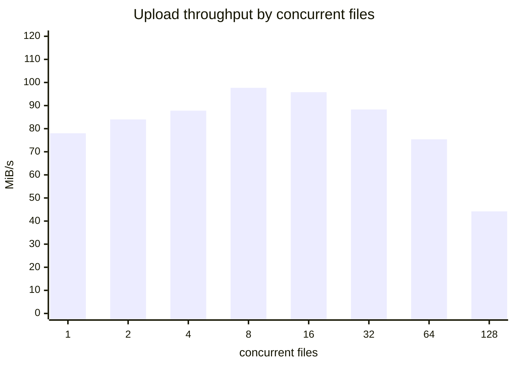
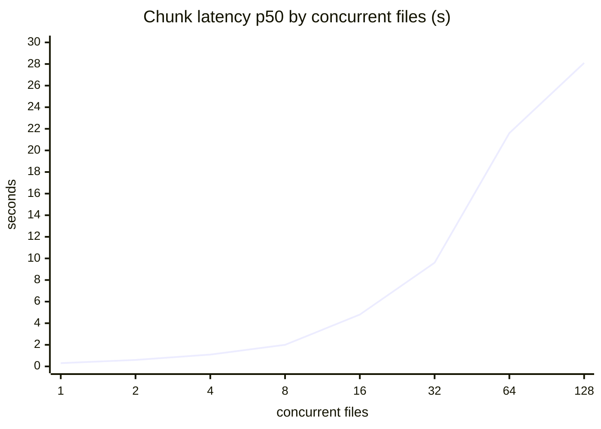

# Final benchmark report (2026-11-11)

Code: `9ecad34` (branch `engineering-hardening`). Raw results are the JSON files next to this report.

## Summary

- Every workload now completes: W1 and W2 failed outright at the start of this work (0/20 and 0/100 uploads, deadlocks); now 20/20 and 100/100 in every run, with no retries and no errors.
- Upload throughput on the local stack (medians of 3): W1 95.4 MiB/s, W2 76.6, W3 83.5; W2 chunk p95 fell from 28.2 s after the deadlock fix to 14.4 s.
- A 5 GiB file uploads at 75.4 MiB/s and downloads at 147 MiB/s with its SHA-256 verified.
- On real S3 (EC2, same region) uploads run at about 168 MiB/s (W1) and parallel ranged reads raise a single 1 GiB download from 76.0 to 284 MiB/s, so the download default changes from 1 to 4.
- On this machine, uploads are limited by the single app process and downloads measured from Windows by Docker Desktop's port forwarding; details below.

## Method

- **Host:** Windows 11 (10.0.26300), 32 logical CPUs, 31 GiB RAM.
- **Docker:** Docker Desktop, engine 29.9.2; its Linux VM has 4 CPUs and 7.8 GB.
- **Server:** one app container (one uvicorn process) from commit 9ecad34, Postgres 16, Versity S3 gateway v1.10.0 (posix backend on a Docker volume), all in that VM.
- **Client:** scripts/load_test.py on the Windows host (Python 3.12.13, httpx 0.28.1) through Docker's port forwarding to localhost:8001.
- **Config:** defaults: 16 storage workers, DB pool 10 + 10, 8 chunks in flight per upload, global in-flight 128, queue 512, download_prefetch 1 (the default when these runs were made).
- **Runs:** W1, W2 and W3 three times each, back to back; the bench bucket is emptied between workloads and sweep points. Medians are per metric.
- **Workloads:** W1 is 20 files of 64 MiB (8 MiB chunks, 8 files at once, 4 chunk workers each, then download and verify); W2 is 100 files of 16 MiB (5 MiB chunks, all at once, 2 workers each); W3 is one 1 GiB file (8 MiB chunks, 8 workers, then download and verify).
- **Commands:** start the stack with `docker compose --profile bench up -d --build app-bench`, then run `python scripts/load_test.py --base-url http://localhost:8001 --workload W1` (or W2, W3) three times. The sweep and 5 GiB commands are in their JSON files; between runs the bench bucket was emptied through the S3 API.
- **The earlier rows are not interleaved with the final runs.** Results vary between sessions on this machine (W1 downloads on the same code measured 113 MiB/s in one session and 148 in another), which is why each change was judged by interleaved A/B runs during the work. Read the before/after table as the trend, not as precise ratios.

## Before and after

Upload MiB/s, chunk latency p50 / p95 / p99 in ms, download MiB/s. n/r: not recorded in that comparison.

| Workload | Code | Uploads | Upload | p50 | p95 | p99 | Download |
|---|---|---|---|---|---|---|---|
| W1 | baseline (bf5c2cb, 1 run) | 0/20 | failed | failed | failed | failed | failed |
| W1 | after the deadlock fixes (6a44032, 1 run) | 20/20 | 52.2 | 3,564 | 6,349 | 6,448 | 122 |
| W1 | after one write per chunk (9c5a7cc, A/B median) | 20/20 | 68.7 | 3,023 | n/r | n/r | 113 |
| W1 | final (9ecad34, median of 3) | 20/20 20/20 20/20 | 95.4 | 2,071 | 3,120 | 3,181 | 170 |
| W2 | baseline (bf5c2cb, 1 run) | 0/100 | failed | failed | failed | failed | failed |
| W2 | after the deadlock fixes (6a44032, 1 run) | 100/100 | 38.0 | 16,330 | 28,168 | 30,024 | n/r |
| W2 | after the completion state machine (279703b, A/B median) | 100/100 | 35.3 | 15,147 | n/r | n/r | n/r |
| W2 | final (9ecad34, median of 3) | 100/100 100/100 100/100 | 76.6 | 7,326 | 14,411 | 15,133 | n/r |
| W3 | baseline (bf5c2cb, 1 run) | 1/1 | 52.6 | 1,010 | 1,575 | 1,704 | 137 |
| W3 | after the deadlock fixes (6a44032, 1 run) | 1/1 | 46.2 | 1,216 | 1,502 | 1,606 | 102 |
| W3 | upload: after race-safe chunk writes (4b3abf0); download: one write per chunk (f743a63); A/B medians | 1/1 | 41.7 | 871 | n/r | n/r | 147 |
| W3 | final (9ecad34, median of 3) | 1/1 1/1 1/1 | 83.5 | 610 | 853 | 918 | 138 |

The baseline W1 and W2 failed because concurrent uploads deadlocked: requests took database connections on the event loop and held them across storage calls (fixed in f81bbbd, b6e0aea and 6a44032); W3, a single file, worked. Later gains come from writing each chunk once (9c5a7cc), streaming downloads (b316762), and sizing the worker and database pools by measurement (60a7ace). All final runs: zero retries, zero errors, every download verified.

## Saturation

W1 file size, 4 chunk workers per file, concurrency doubling from 1 to 128 files.

| Concurrent files | Requests in flight | Uploads | Upload MiB/s | p50 s | p95 s | p99 s | 429/503 retries | Errors |
|---|---|---|---|---|---|---|---|---|
| 1 | 4 | 8/8 | 78.0 | 0.3 | 0.4 | 0.4 | 0 | none |
| 2 | 8 | 8/8 | 84.0 | 0.6 | 0.8 | 0.9 | 0 | none |
| 4 | 16 | 8/8 | 87.8 | 1.1 | 1.6 | 1.7 | 0 | none |
| 8 | 32 | 8/8 | 97.7 | 2.0 | 2.9 | 2.9 | 0 | none |
| 16 | 64 | 16/16 | 95.8 | 4.8 | 5.2 | 5.6 | 0 | none |
| 32 | 128 | 32/32 | 88.3 | 9.6 | 12.9 | 13.4 | 0 | none |
| 64 | 256 | 64/64 | 75.4 | 21.6 | 38.5 | 43.9 | 0 | none |
| 128 | 512 | 51/128 | 44.2 | 28.1 | 60.5 | 62.5 | 0 | transport:ConnectError: 270, transport:RemoteProtocolError: 6 |

- **Peak at 8 concurrent files** (97.7 MiB/s). Beyond it, adding files only adds waiting: at 64 files, 256 requests in flight completing 9.4 chunks per second predicts about 27 s per chunk (Little's law); the median was 21.6 s.
- **The server never throttled.** No request got 429 at any point: its admission limits (a queue of 512 per instance) were not reached. The spec's queue saturation threshold therefore lies above 512 chunk requests in flight per instance, beyond what this machine could deliver.
- **The 128-file failures happened before the app.** Windows refused connections to the forwarded port (`WinError 10061`, 270 attempts; 205 in a repeat run). Every request that reached the app succeeded, the app logged no error, and its memory peaked at 2.46 GiB. 512 simultaneous short uploads (1 MiB) passed both through port forwarding (512/512) and inside the Docker network (512/512), so the refusals need many long-lived forwarded connections. This is Docker Desktop on Windows; a Linux host or a load balancer in front of the app does not use that forwarder.

## One 5 GiB file

640 chunks of 8 MiB, 8 in parallel: upload 75.4 MiB/s (chunk p50 631 ms, p95 811 ms, p99 1078 ms), download 146.6 MiB/s with the SHA-256 verified, no retries, no errors.

## Real S3 (EC2, same region)

c6i.xlarge (4 vCPU, 8 GiB) in us-east-1 running the app, Postgres and the load test, against an S3 bucket in the same region; 3 interleaved rounds per setting. Details: `2026-11-11_s3_download-prefetch.json`.

| Download setting (W3, one 1 GiB file) | Download MiB/s (median) | Buffers per download |
|---|---|---|
| read-ahead 1 (one streaming GET per piece) | 76 | 8 MiB |
| read-ahead 4, 8 MiB segments (new default) | 284 | about 40 MiB |
| read-ahead 8, 8 MiB segments | 321 | about 72 MiB |
| read-ahead 8, 16 MiB segments | 364 | about 144 MiB |

W1 on S3 with the defaults of the time: upload 168 MiB/s, download 436 MiB/s (8 files at once). Every run verified every file with zero retries. Each S3 GET waits on a network round trip, so one sequential stream per piece is latency-bound; parallel ranged GETs overlap the waits. On the local stack the opposite held (about 10% slower, 2026-11-09_download_ab-task10-vs-task11.json), so storage on the same host can set `DOWNLOAD_PREFETCH=1`.

## Retries and errors

Retries count 429 and 503 answers the load test retried after Retry-After. Across W1, W2, W3 (9 runs), the 5 GiB run and the sweep: zero retries. The only errors in this report are the connection refusals at 128 concurrent files described above.

## What limits throughput now

1. **Uploads: the single app process.** From inside the Docker network (no port forwarding), W1 uploads at 105 and 116 MiB/s with one instance and 142 and 154 MiB/s with two instances behind nginx, about 35% more on the same 4-CPU VM. During W1 from the host the app averaged about 72% of a core, the S3 gateway 26% and Postgres 6%: the VM had idle CPU, so the limit is per process, not the machine. The likely cause is the single event loop and the parts of request handling that Python's GIL serializes; these runs do not separate the two. Running several instances, as the cluster profile does, is the lever. Two runs each: indicative, not conclusive.
2. **Downloads measured from Windows: Docker Desktop's port forwarding.** The same W1 downloads reach 471 and 415 MiB/s inside the Docker network, against a median of 170 through port forwarding. The final download numbers above are therefore a property of this test setup, not of the service.
3. **More concurrency per instance only adds waiting.** Past 8 concurrent files the throughput stays flat or falls and latency grows in proportion to the requests in flight (Little's law above): requests queue for the same per-process capacity as in item 1. More instances help; more concurrent requests to one instance do not.
4. **Many concurrent connections on Windows.** Port forwarding refused connections at 512 long-lived requests; the server's own limits were not reached first.
5. **Memory under heavy concurrency.** A chunk body is read into memory before its upload's slot is taken, so memory grows with concurrent requests (2.46 GiB at 512 requests of 8 MiB). Nothing caps this today; a byte budget for request bodies would.

## Not measured

- Multi-region or cross-region transfer, and S3 throughput beyond one 4 vCPU instance.
- Downloads with read-ahead 4 on the local stack in this session (measured earlier in 2026-11-09_download_ab-task10-vs-task11.json: about 10% slower than streaming there).
- The two-instance comparison ran twice; treat its 35% as indicative.
